<div align="center">

<picture>
  <source media="(prefers-color-scheme: dark)" srcset="public/logo_darkmode.svg">
  
</picture>

# Spent

**Local-only personal finance for Israeli bank accounts.**
Encrypted. AI-categorized. Yours.

[](https://david1x.github.io/Spent/)
[](https://david1x.github.io/Spent/getting-started)
[](https://david1x.github.io/Spent/install/mac)

[](https://nextjs.org/)
[](https://react.dev/)
[](https://www.typescriptlang.org/)
[](https://sqlite.org/)
[](#license)
[](#features)

</div>

> [!WARNING]
> Personal, local-only tool. Scraping financial institutions may violate their Terms of Service. Use only for your own accounts on your own machine. **Do not deploy as a hosted service.**

<div align="center">

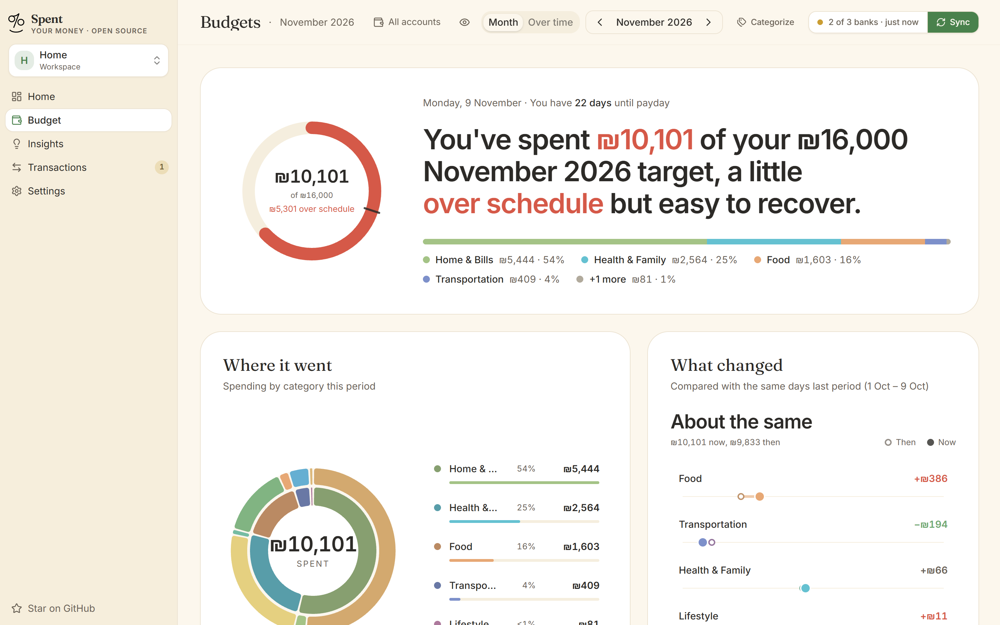

</div>

## Why Spent?

Israeli banks have terrible exports, YNAB doesn't speak ILS gracefully, and every "cloud finance" app wants you to hand over your bank password. Spent is the answer for people who'd rather just run something on their own laptop.

Your transactions get pulled directly from your bank with [`israeli-bank-scrapers`](https://github.com/eshaham/israeli-bank-scrapers), stored in a local SQLite file you can `cp` and back up like any other file, and categorized by an AI provider you choose: paid Claude, free local Ollama, or nothing at all.

The trade-off is honest: you self-host, you trust the scraper, and you accept that banks may not love automation. In return you get a fast, beautiful, fully offline dashboard that never phones home.

## Features

<table>
<tr>
<td width="33%" valign="top">

### 🏦 Israeli banks and cards
Isracard, Visa Cal, Max, Bank Hapoalim and Bank Leumi, plus the other banks and card companies [`israeli-bank-scrapers`](https://github.com/eshaham/israeli-bank-scrapers) supports. See [Supported banks](#supported-banks).

</td>
<td width="33%" valign="top">

### 🤖 AI categorization
Choose Claude (Anthropic) for best accuracy, Ollama for fully local LLMs, or skip and categorize manually.

</td>
<td width="33%" valign="top">

### 🔒 Local-only & encrypted
Credentials encrypted with AES-256-GCM. Server binds to `127.0.0.1` only, so it's never reachable from your LAN or the internet.

</td>
</tr>
<tr>
<td valign="top">

### 📊 Budgets with pacing
Hierarchical categories, monthly targets, an "ahead of pace" hero card, a "what changed" comparison with last month, and per-category drilldown.

</td>
<td valign="top">

### 📈 Spending over time
Switch Budgets to **Over time** to see each month of the last year, or any range of months: spending split by category, the months you stayed within target, and a category by month grid.

</td>
<td valign="top">

### 💳 Choose your cards
A quick card check signs in and lists every card on an Isracard login, cancelled ones included, in about 20 seconds. Pick which cards sync, sync one card on its own, and send each card to the right workspace.

</td>
</tr>
<tr>
<td valign="top">

### 📥 Import bank exports
Drop in a CSV or Excel file exported from any bank. Spent guesses the columns (Hebrew or English), shows a preview, and skips rows it already has. Handy when a bank blocks automated sign-in.

</td>
<td valign="top">

### ✏️ Your own names
Rename a cryptic bank line like `חיוב צק/12345/0001002/10` to "Rent", add a note, and give the same name to that payee's other transactions in one click.

</td>
<td valign="top">

### 🗂 Workspaces
Separate budgets for you, your home or a side business. Move a bank login or a single card between workspaces; syncing a workspace also covers the cards moved into it. Share a workspace with your partner as view-only: they can look, and suggest a category for you to approve.

</td>
</tr>
<tr>
<td valign="top">

### 🎯 Auto-detected transfers
Credit card payments and inter-account moves are recognized and excluded from spending totals.

</td>
<td valign="top">

### 🔄 Live everywhere
Change a category or a name and every open page and tab updates within seconds. Syncs and background categorizing show up as they land.

</td>
<td valign="top">

### 🔍 Merchant memory
Once you correct an AI categorization, Spent remembers: the same merchant goes to the right category next time. Payments that differ only by a running number (check numbers) count as one payee.

</td>
</tr>
<tr>
<td valign="top">

### 🌓 Light & dark theme
Polished buttercream-and-sage palette in light mode, warm charcoal in dark. System-aware by default.

</td>
<td valign="top">

### 🍎 Menu bar / tray app
Native companion in your menu bar (macOS) or notification area (Windows). Status indicator, one-click open dashboard, sync, and start/stop/restart the service.

</td>
<td valign="top">

### 📅 Multi-month history
Pull up to 3 months of transactions per sync (configurable). Most banks support 12 months total.

</td>
</tr>
<tr>
<td colspan="3" valign="top">

### 🌐 English & Hebrew (RTL)
Toggle between English (default) and עברית from **Settings → Appearance**. Hebrew flips the entire app to right-to-left with translated UI, bank names, predefined categories, currency, and date formatting. Powered by [`next-intl`](https://next-intl.dev/): drop in a new `<locale>.json` under [`src/i18n/messages/`](src/i18n/messages/) to add another language.

</td>
</tr>
</table>

## Screenshots

All screenshots use invented demo data.

<table>
<tr>
<td width="50%" align="center"><b>Budgets, this month</b></td>
<td width="50%" align="center"><b>Home, dark theme</b></td>
</tr>
<tr>
<td></td>
<td>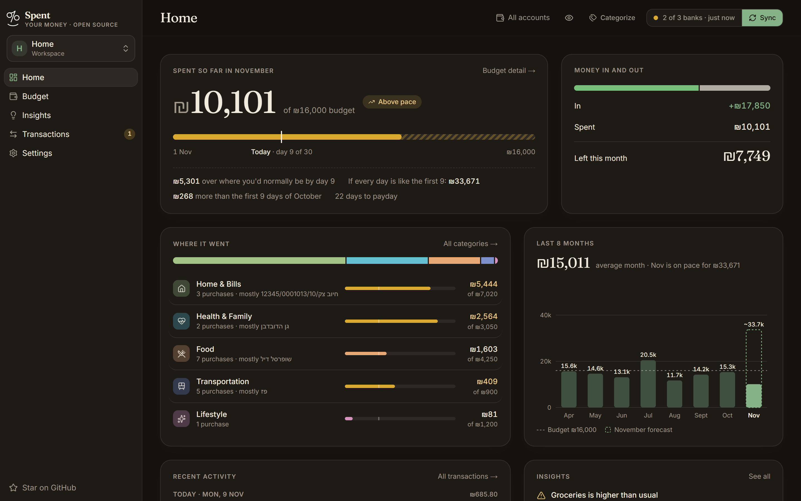</td>
</tr>
<tr>
<td align="center"><b>Spending over time</b></td>
<td align="center"><b>Transactions</b></td>
</tr>
<tr>
<td>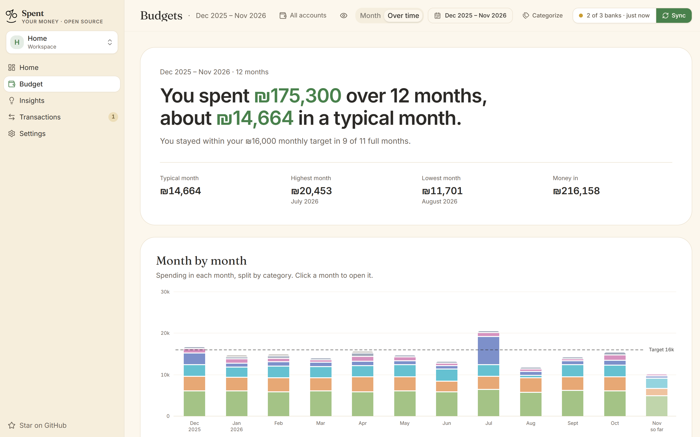</td>
<td>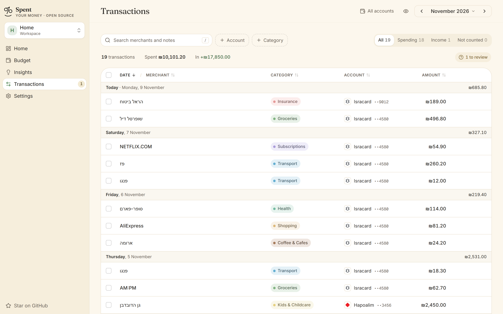</td>
</tr>
<tr>
<td align="center"><b>Choose which cards sync</b></td>
<td align="center"><b>Import a bank export</b></td>
</tr>
<tr>
<td>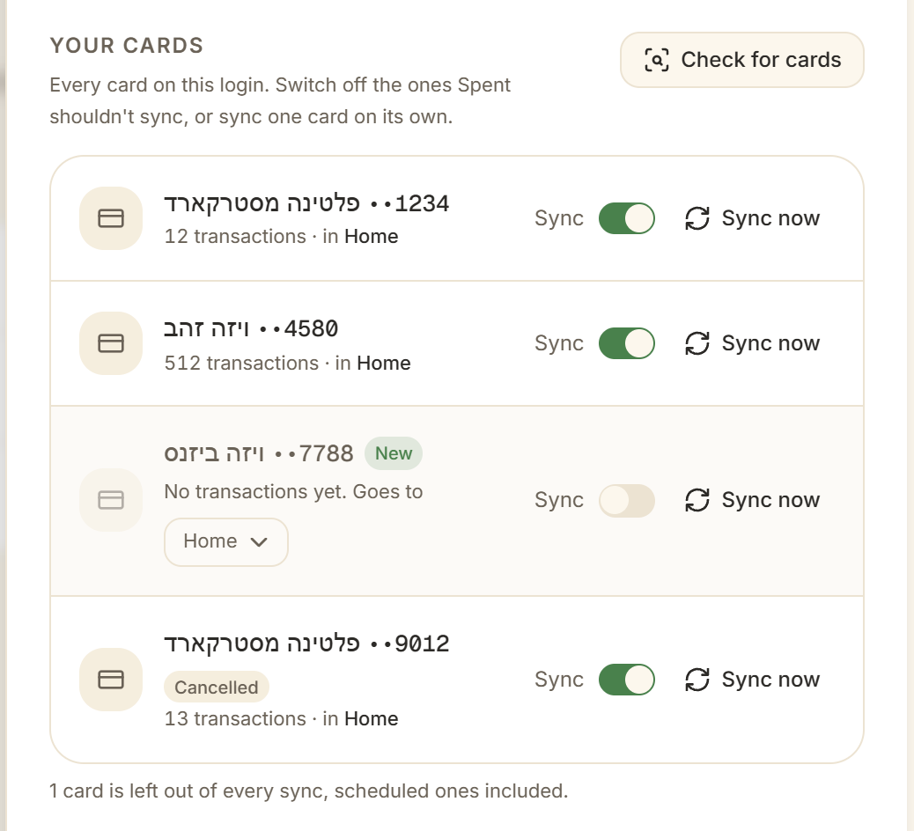</td>
<td>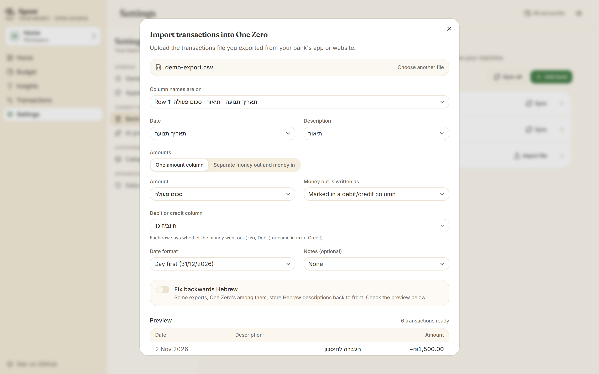</td>
</tr>
<tr>
<td align="center"><b>Bank accounts</b></td>
<td align="center"><b>Adding a bank</b></td>
</tr>
<tr>
<td>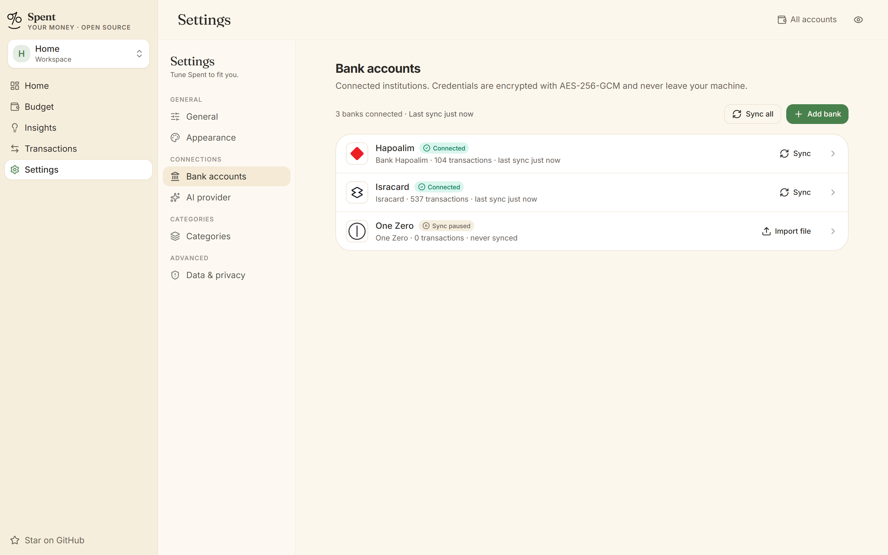</td>
<td>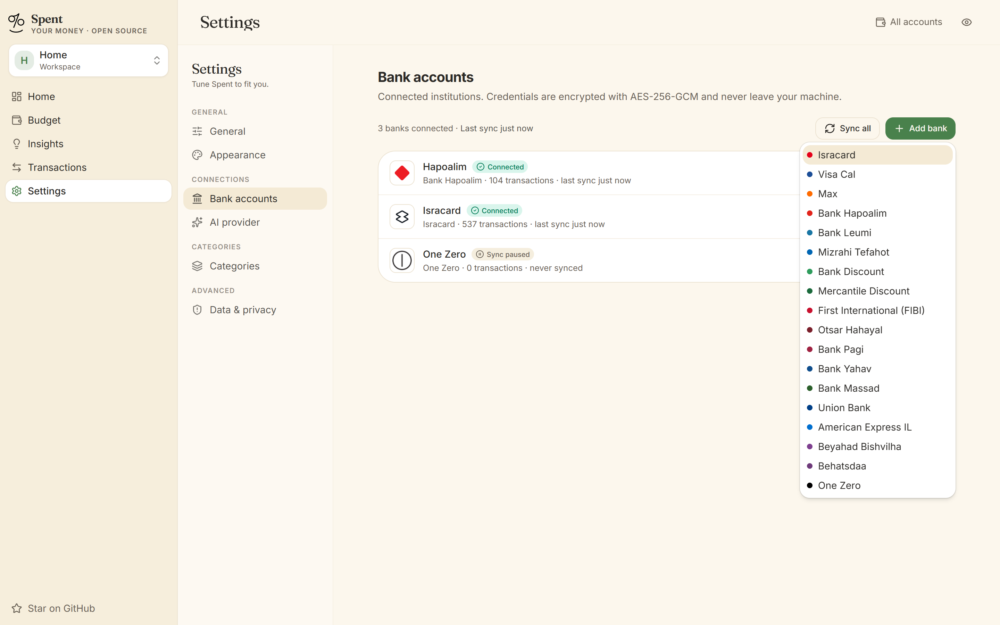</td>
</tr>
<tr>
<td align="center"><b>Categories</b></td>
<td align="center"><b>AI provider</b></td>
</tr>
<tr>
<td>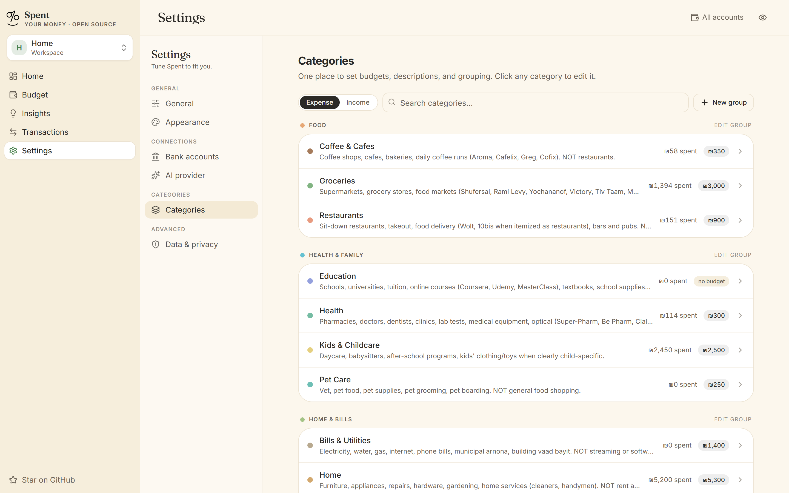</td>
<td>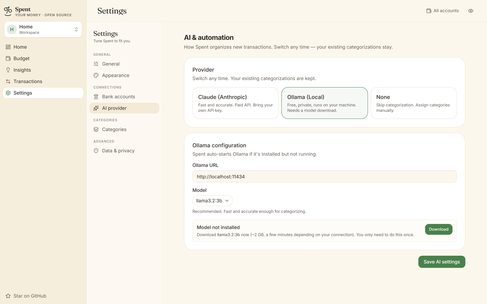</td>
</tr>
</table>

## How it works

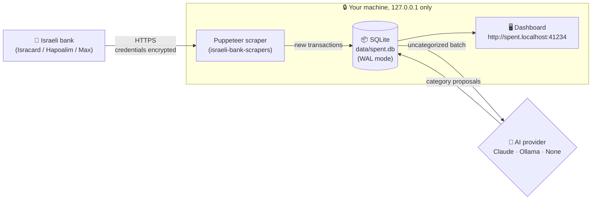

Everything inside the dashed box stays on your laptop. The only outbound traffic is to your bank (for scraping) and optionally `api.anthropic.com` (if you chose Claude) or `localhost:11434` (if you chose Ollama).

## Supported banks

| Bank | Type | Status |
|---|---|---|
| **Isracard** | Credit card | ✅ Supported. Every card on the login, including cards from other Isracard group companies and cancelled cards that still carry standing charges. Choose which cards sync. |
| **Visa Cal** | Credit card | ✅ Supported |
| **Max** (formerly Leumi Card) | Credit card | ✅ Supported |
| **Bank Hapoalim** (incl. Poalim wallets) | Bank | ✅ Supported |
| **Bank Leumi** | Bank | ✅ Supported |
| American Express IL, Beyahad Bishvilha, Behatsdaa | Credit card | 🧪 Available, less tested |
| Mizrahi Tefahot, Discount, Mercantile, First International, Otsar Hahayal, Pagi, Yahav, Massad, Union | Bank | 🧪 Available, less tested |
| One Zero | Bank | ⏸️ Sync paused: its firewall currently blocks the scraper ([israeli-bank-scrapers#1144](https://github.com/eshaham/israeli-bank-scrapers/issues/1144)). Import the transactions file you export from the app instead. |

Any bank can also bring transactions in from an exported CSV or Excel file (**Settings → Bank accounts → Import file**).

Don't see your bank? Adding a scraper is a small wrapper around `israeli-bank-scrapers`. See [Contributing](#contributing).

## AI providers

| | **Claude** (Anthropic) | **Ollama** (local) | **None** |
|---|---|---|---|
| Cost | ~₪0.004 per sync | Free | Free |
| Accuracy | Best | Good (depends on model) | Manual |
| Network | `api.anthropic.com` | `localhost:11434` | Offline |
| Setup | API key | Install Ollama + pull a model | Nothing |

Default model when Claude is selected: `claude-haiku-4-5` (cheap, fast, accurate for categorization). For Ollama, `llama3.2:3b` is the recommended default.

You can change providers any time from **Settings → AI provider**. Existing categorizations are kept.

## Requirements

- **Node.js 22+**
- **macOS 13+**, **Ubuntu 22+** (with systemd), or **Windows 11**
- **Build tools for the menubar** (only if you want the tray; `npm run setup` will offer to install these for you if they're missing):
  - macOS: Xcode Command Line Tools (`xcode-select --install`)
  - Windows: .NET 8 SDK (`winget install Microsoft.DotNet.SDK.8`)
- A bank account with **2FA disabled** (most Israeli banks require this for automation)

## Install

> Prefer a screenshot-by-screenshot walkthrough? The [step-by-step install guides](https://david1x.github.io/Spent/getting-started/) on the docs site cover macOS and Windows separately, with build-tool setup and tray-app gotchas spelled out.

```bash
git clone https://github.com/david1x/Spent.git
cd spent
npm install
npm run setup
```

`npm run setup` does everything: builds the Next.js app, installs the always-on service (LaunchAgent on macOS / systemd on Linux / Task Scheduler on Windows), builds the platform menubar from source, installs it to the standard location, registers it to auto-start at login, and opens the dashboard. On Windows it also writes a `127.0.0.1 spent.localhost` line to your hosts file (the only step that asks for Administrator). macOS and Linux resolve `*.localhost` natively, so setup runs sudo-free there.

On Linux there is no native menubar. `npm run setup` installs the service and opens the browser. Control the service with `npm run service:*` (see below).

First launch of the menubar on macOS/Windows shows an unsigned-binary warning (Gatekeeper / SmartScreen). That's expected: you built it locally and didn't pay for a code-signing certificate. Right-click → Open (macOS) or "More info" → "Run anyway" (Windows). One-time.

Open **`http://spent.localhost:41234`** and bookmark it.

### Docker (Linux server)

```bash
git clone https://github.com/david1x/Spent.git
cd Spent
docker compose up -d --build
```

Open `http://127.0.0.1:4005`. The image bundles Chromium for the bank scrapers, and your data lives in the `spent-data` volume (`/data` in the container), so rebuilding or updating the image keeps it. Spent has no login screen, so the port only answers on the host by default. To reach it from other devices on a network you trust, change the port line in `docker-compose.yml` to `"4005:4005"`. `SPENT_PORT=4010 docker compose up -d` picks another host port.

"Show browser during sync" needs a screen, so it doesn't work in Docker. Sync banks that need manual 2FA from a desktop install, or turn 2FA off for them.

### Putting Spent on a domain

Spent has no sign-in by default, because on your own computer there is nothing to sign in to. Before you make it reachable from other devices or the internet, turn on **Settings → Security → Turn on sign-in**: a name and a password. The 6-digit code from an authenticator app (Google Authenticator, 1Password, Bitwarden and others), with ten single-use recovery codes, is optional but recommended for anything on the internet; add or remove it later on the same page.

- Serve it over HTTPS through a reverse proxy (Caddy, Traefik, nginx). The session cookie is marked secure when requests arrive over HTTPS.
- Set `SPENT_AUTH_REQUIRED=1` (there's a commented line in `docker-compose.yml`) so even a fresh install asks you to create the sign-in before anything else, including setup and restore.
- Locked out (forgot the password, or lost your phone and recovery codes)? On the server: `npm run auth:reset`, or `docker exec spent node scripts/reset-sign-in.mjs`. It turns sign-in off and leaves your data alone.

### Sharing with someone

With sign-in on, **Settings → Sharing** makes an invite link for the workspaces you pick. The person who opens it creates their own name and password (and, if they want, an authenticator code), and from then on sees those workspaces read-only: transactions, budgets, insights. They can't sync, edit, set budgets, see bank logins or open Settings; the server enforces that, not just the screens.

The one thing they can do is suggest a different category for a transaction. Suggestions wait on your Home and Transactions pages until you approve or decline them; approving applies the category as if you'd picked it. Links work once and expire after 7 days. You can change what each person sees, sign them out, or stop sharing at any time; turning sign-in off ends all sharing.

## First-time setup

In the browser:

1. **Connect your bank**: credentials are AES-256-GCM encrypted before they touch disk.
2. **Choose an AI provider**: Claude (default), Ollama, or none.
3. **Set your monthly ceiling**: the total spend you want to stay under each month.
4. **Set per-category budgets**: type an amount on any category to budget it; leave blank to track without a limit.
5. **Done.** Sync starts automatically: 3 months of transactions, then AI categorization.

## How you'll use it

| What you want | Run |
|---|---|
| Just use the app (no coding) | Open `http://spent.localhost:41234` |
| Code and see changes instantly | `npm run dev` → `http://127.0.0.1:4005` |
| Update the always-on app after editing | `npm run service:reload` |

Rare cases:

- Changed the menu bar app source → `npm run menubar:install:mac` (or `:windows`) to rebuild and reinstall.
- Changed install scripts or hostname → `npm run service:uninstall && npm run service:install`.

## Service commands

| Command | What it does |
|---|---|
| `npm run service:status` | Running? Bound to loopback? |
| `npm run service:start` / `:stop` | Start/stop now |
| `npm run service:reload` | Rebuild and restart |
| `npm run service:logs` | Tail server logs |
| `npm run service:open` | Open the app in your browser |
| `npm run service:uninstall` | Remove auto-start and hosts entry. `data/` is untouched. |

## Uninstall

```bash
npm run uninstall
```

Reverses everything `npm run setup` installed:

- Stops the background service and removes the LaunchAgent / Task Scheduler entry / systemd unit.
- Windows: removes the `127.0.0.1 spent.localhost` line from your hosts file (asks for Administrator). macOS/Linux don't have a hosts entry to remove unless you're upgrading from an older install; in that case the legacy `spent.local` line is cleaned up automatically.
- Quits the menubar, removes the installed app, and removes it from Login Items / Startup.

**Kept on purpose:**

- `data/`: your transactions, budgets, and encryption key. To wipe your data: `rm -rf data/`.
- The repo itself. To remove Spent entirely: `rm -rf data/ && cd .. && rm -rf spent/`.

If you only want to remove the menubar but keep the always-on web app:

- **macOS**: `rm -rf ~/Applications/Spent.app` and remove "Spent" from System Settings → General → Login Items.
- **Windows**: delete `%LOCALAPPDATA%\Programs\Spent\` and remove `Spent.lnk` from `shell:startup`.

If you only want to remove the always-on service but keep the menubar (so it's there if you reinstall later): `npm run service:uninstall`.

## Security at a glance

| Concern | Defense |
|---|---|
| Credentials at rest | AES-256-GCM, encryption key file mode `0600` (server refuses to start otherwise) |
| Network exposure | Bound to `127.0.0.1` only, not reachable from your LAN or the internet |
| Browser CSRF | Origin / Referer validation on every mutation |
| Bot detection | Chromium sandbox on by default (`SPENT_DISABLE_CHROMIUM_SANDBOX=1` to opt out) |
| Bundle integrity | `israeli-bank-scrapers`, `better-sqlite3`, and `@anthropic-ai/sdk` pinned to exact versions |
| Browser hardening | Strict CSP, `X-Frame-Options: DENY`, `Permissions-Policy` locks down camera/mic/geo/payment |

**Turn on full-disk encryption** (FileVault / BitLocker / LUKS). The encryption key file sits next to the database, so disk-level protection is your last line of defense if the laptop is lost.

Full threat model and responsible-disclosure policy → [SECURITY.md](SECURITY.md).

## Where your data lives

- `data/spent.db`: transactions, categories, budgets, settings
- `data/.encryption-key`: 32-byte AES key, mode `0600`
- `~/Library/Logs/Spent/` (macOS) / `~/.local/state/spent/log/` (Linux): service logs

To move to a new machine (or into Docker), use **Settings → Data & privacy → Backup and restore**: it saves everything, including your encrypted bank logins and the key that unlocks them, as one password-protected file. Restore it on the new install from the same screen, or from the first setup screen. Copying `data/` over by hand also works. Set `SPENT_DATA_DIR` to keep the database and key somewhere other than `data/`.

## Architecture & code map

```
spent/
├── src/
│   ├── app/                  Next.js App Router (routes + API)
│   │   ├── (dashboard)/      Dashboard, transactions, settings pages
│   │   ├── api/              Sync (SSE), summary, transactions, setup
│   │   └── setup/            First-run wizard
│   ├── components/
│   │   ├── dashboard/        Hero card, category grid, budget drawer
│   │   ├── setup/            Bank, AI, target, budgets steps
│   │   └── settings/         Per-tab settings panels
│   ├── lib/                  Shared client-side types and helpers
│   └── server/
│       ├── ai/               Claude + Ollama provider implementations
│       ├── db/               SQLite singleton, migrations, query helpers
│       ├── lib/              Encryption, dedup, transfer detection, pace
│       └── scrapers/         Wrapper around israeli-bank-scrapers
├── menubar/                  Tray companions (built locally by `npm run setup`)
│   ├── mac/                  Swift MenuBarExtra app
│   └── windows/              C# WinForms NotifyIcon app
├── scripts/service/          LaunchAgent / systemd / Task Scheduler installer
├── website/                  Astro + Starlight docs site (auto-deploys to GitHub Pages)
├── .github/workflows/        CI: docs site deploy
├── Spent.sln                 Visual Studio solution for the Windows menubar project
└── data/                     SQLite + encryption key (gitignored)
```

## Troubleshooting

> The [Troubleshooting docs](https://david1x.github.io/Spent/troubleshooting/) cover Defender, Gatekeeper, Cloudflare bot challenges, and bank-specific quirks in more depth.

- **Port 41234 in use** → `lsof -nP -iTCP:41234 -sTCP:LISTEN` (Unix) or `netstat -ano | findstr :41234` (Windows). Kill the offender and re-run install.
- **Gatekeeper blocks `Spent.app`** → right-click → Open → Open. One-time.
- **Linux: "systemd user instance not available"** → `loginctl enable-linger $USER`.
- **Windows: hosts edit fails / `spent.localhost` doesn't resolve** → re-run install from an elevated PowerShell (Win+X → "Terminal (Admin)") so it can edit `C:\Windows\System32\drivers\etc\hosts`. After the edit, the installer flushes the DNS cache automatically; if you edited hosts manually, run `ipconfig /flushdns`. `http://127.0.0.1:41234` always works as a fallback.
- **One Zero shows "Sync paused"** → its firewall blocks the scraper for now. Export your transactions from the One Zero app and use **Import file** on its row in **Settings → Bank accounts**.
- **An Isracard card is missing** → open the Isracard connection and press **Check for cards**. Cards that are switched off there are left out of every sync.
- **Bank scrape fails with "Cloudflare"** → temporarily run with `SPENT_DISABLE_CHROMIUM_SANDBOX=1` to let Puppeteer use a real Chrome profile.

## Roadmap

- [x] Hebrew UI with full RTL layout
- [x] Visa Cal and Bank Leumi
- [x] Import exported CSV / Excel files
- [x] Spending over time and custom month ranges
- [x] Choose which cards of a login sync
- [ ] One Zero sync (blocked upstream, [israeli-bank-scrapers#1144](https://github.com/eshaham/israeli-bank-scrapers/issues/1144))
- [ ] CSV / OFX export
- [ ] Custom user-defined categories
- [ ] Mobile companion (Phase 2)
- [ ] Multiple workspaces in the menu bar / tray app

## Contributing

Spent is built for personal use first, open-source second. PRs welcome for:

- **New bank integrations**: add to `BANK_PROVIDERS` in [src/lib/types.ts](src/lib/types.ts), map to `CompanyTypes` in [src/server/scrapers/index.ts](src/server/scrapers/index.ts), flip `enabled: true`.
- **New AI providers**: implement the `AIProvider` interface from [src/server/ai/types.ts](src/server/ai/types.ts), register in [src/server/ai/factory.ts](src/server/ai/factory.ts), and add an option to the setup wizard.
- **New languages**: add `<locale>.json` under [src/i18n/messages/](src/i18n/messages/), mirroring the keys in `en.json`, and append the locale to [src/i18n/routing.ts](src/i18n/routing.ts). Toggle wires itself up automatically.
- **UI polish, bug fixes, documentation.**

Conventions:

- TypeScript strict mode. No `any` without a comment.
- Conventional commits: `feat:`, `fix:`, `chore:`, `docs:`, `refactor:`.
- Comments only where the "why" isn't obvious. No em dashes in code, commits, or docs.

## License

MIT

## Acknowledgments

Built on the shoulders of:

- [`israeli-bank-scrapers`](https://github.com/eshaham/israeli-bank-scrapers): the heart of every bank integration
- [Next.js 16](https://nextjs.org/) and [React 19](https://react.dev/)
- [`shadcn/ui`](https://ui.shadcn.com/) on top of [`base-ui`](https://base-ui.com/)
- [`better-sqlite3`](https://github.com/WiseLibs/better-sqlite3)
- [`next-intl`](https://next-intl.dev/) for English / Hebrew i18n
- [Anthropic Claude](https://www.anthropic.com/) and the local-LLM crew at [Ollama](https://ollama.com/)
